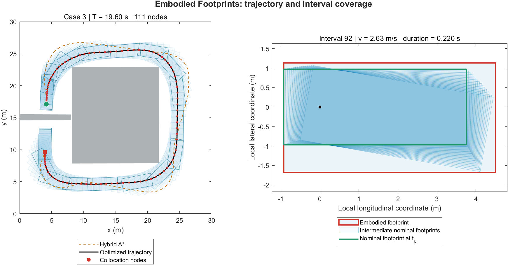
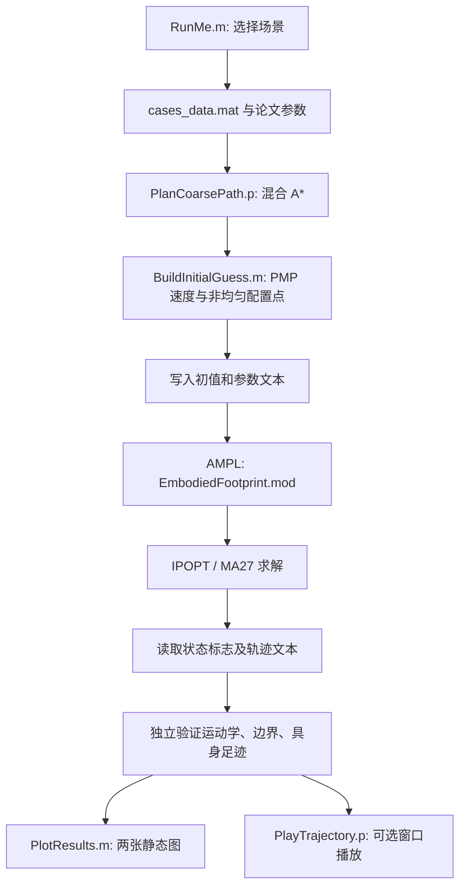

# Embodied Footprints / 具身足迹

[下载 ZIP](https://github.com/libai1943/EmbodiedFootprints/archive/refs/heads/main.zip) · [从这里开始](#选择实现) · [阅读指南](#文件与函数说明)

本仓库是中文图书 **《非结构化场景自动驾驶轨迹规划技术》** 第十一章“基于具身足迹理论的避障约束离散化误差消除方法”的配套轨迹规划示例，依据作者的历史研究代码整理。

English title translation: *Trajectory Planning Techniques for Autonomous Driving in Unstructured Environments*. **The book is written in Chinese.** This repository accompanies Chapter 11 and implements the embodied-footprint model and its optimization-based trajectory planner.

本例展示如何在有限配置点处约束**具身足迹**，使每个扩张后的矩形承担覆盖下一时间区间内车身扫掠区域的任务。请结合书中第十一章与下述论文阅读公式、成立条件和规划流程。

使用本代码开展研究并发表成果时，请引用：

> Bai Li, Youmin Zhang, Tantan Zhang, Tankut Acarman, Yakun Ouyang, Li Li, Hairong Dong, and Dongpu Cao, “Embodied Footprints: A Safety-Guaranteed Collision-Avoidance Model for Numerical Optimization-Based Trajectory Planning,” *IEEE Transactions on Intelligent Transportation Systems*, 25(2):2046–2060, 2024. [DOI: 10.1109/TITS.2023.3316175](https://doi.org/10.1109/TITS.2023.3316175).

论文于 2023 年在线发表，正式卷期为 2024 年。[BibTeX](CITATION.bib) 随仓库提供。

## 实际运行效果

下图由本仓库第三个算例实际求解生成。左侧为完整轨迹与具身足迹，右侧为一个时间区间在车辆局部坐标系下的覆盖关系：红框是具身足迹，绿色轮廓是区间起点的名义车身，蓝色轮廓为区间内的车身足迹。



每次运行生成 **两张静态图**：

1. 混合 A* 路径、优化轨迹、配置点和足迹，以及一个具身足迹覆盖区间的局部展示。足迹先画，轨迹后画。
2. 最优速度、朝向、前轮转角、加速度、转角速率、曲率、区间行驶距离，以及初始和优化后的时间间隔对比。

可选动画仅在 MATLAB 窗口中播放，不提供录制、视频编码、GIF 或文件导出接口。静态绘图源码开放；动画与混合 A* 仅提供 P-code。

## 选择实现

| 想做的事 | 入口 | 结果 |
| --- | --- | --- |
| 对照书中推导，查看轨迹和某个时间区间的足迹覆盖 | [MATLAB 示例](RunMe.m)，依赖见下文 | 两张静态图、数值解、求解日志与独立验证结果 |
| 批量读取轨迹，或把结果送入自己的分析程序 | [C++17 实现](cpp/src/main.cpp)，采用 CasADi/IPOPT 和随附搜索库 | 每个配置点的时间、状态和控制量写入 `trajectory.csv` |

**C++ 示例。** 在仓库根目录运行下列命令。示例按 Linux x86-64 单配置构建编写，需 CMake 3.16 或更高版本、C++17 编译器，以及带 IPOPT 插件的 CasADi C++ 开发包。将 `casadi_DIR` 改为本机包含 CasADi CMake 包配置文件的目录。

```sh
cmake -S cpp -B build -Dcasadi_DIR=/path/to/casadi/cmake
cmake --build build --config Release
./build/embodied_footprints --case 3 --linear-solver mumps --output results/cpp_case_3
```

程序从 `cpp/data/case_3.txt` 读取场景，完成搜索、初值构造、优化和独立校验后写入 CSV。查看终端的 `independent_validation=passed`、`nodes` 与 `duration` 可核对这次结果。C++ 示例默认使用 MUMPS，下面的 MATLAB 示例按论文配置使用 MA27。

## MATLAB 一键运行

完成下文依赖配置后，在 MATLAB 打开仓库根目录，修改 [`RunMe.m`](RunMe.m) 中：

```matlab
case_id = 3;                 % 1、2、3 三选一
play_animation = false;     % true：计算后播放动画
```

点击 **Run** 即可。也可执行：

```matlab
run('RunMe.m')
```

三个场景均来自历史代码，分别为弯曲通道、连续转弯通道和绕行矩形障碍物的场景；地图范围为 `30 m × 30 m`。每次运行都会执行路径搜索、初值生成和 NLP 求解。`data/cases_data.mat` 只保存障碍物和起终点，未保存预计算的最优轨迹。

结果写入 `results/case_1/`、`results/case_2/` 或 `results/case_3/`：

| 文件 / 工作区变量 | 内容 |
| --- | --- |
| `result.mat` | 优化结果、初值、搜索路径、场景参数、验证结果及实测规划时间 |
| `trajectory.txt` | 各节点的 `x y theta v a phi w dt`，每行一个配置点 |
| `solver.log` | AMPL/IPOPT 求解日志 |
| `trajectory` | MATLAB 工作区中的最优轨迹结构体；`time` 为节点时间戳 |
| `figures` | 两张静态图的句柄 |

最后一个节点的 `dt` 设为 `0`，有效时间区间数为节点数减一。绘图时间和动画播放时间不计入 `planning_seconds`。求解失败或最终约束验证失败会报错，不会把旧的 TXT 文件当成新结果。

## 安装与部署

### 1. MATLAB

已在 **Windows x64、MATLAB R2021b** 验证三个算例。受保护组件使用该版本生成 P-code。需要 **Image Processing Toolbox**，用于混合 A* 地图的栅格膨胀；无须 MATLAB Optimization Toolbox，也不需要 MATLAB 与 AMPL 的 API 接口。

### 2. AMPL、IPOPT 与 MA27

论文采用 MATLAB + AMPL + IPOPT，IPOPT 的线性求解器为 HSL MA27；本例保留这一流程。请从 [AMPL 官方入口](https://ampl.com/start-free-now/)安装适合自身使用场景的 AMPL 和 IPOPT，并配置有效许可证。HSL MA27 及其依赖按 [COIN-HSL 官方许可与安装说明](https://licences.stfc.ac.uk/product/coin-hsl)配置。

将可执行文件及配套动态库放在仓库的 `runtime/`，例如 Windows 下：

```text
runtime/
  ampl.exe
  ipopt.exe
  ...本机发行包要求的动态库和许可文件...
```

也可以直接使用已有安装目录，无须复制文件：

```matlab
setenv('EF_SOLVER_DIR','C:\Tools\AMPL');
run('RunMe.m');
```

该目录应包含 AMPL、可由其调用的 IPOPT 及所需运行库。MATLAB 会临时将其加入进程的 `PATH`。第三方可执行文件、HSL 动态库和许可证不在 GitHub 仓库中重新分发。

求解器选项位于 [`models/ipopt.opt`](models/ipopt.opt)，默认 `linear_solver ma27`、`tol 1e-3`、`constr_viol_tol 1e-7`。若使用只带 MUMPS 的 IPOPT 发行包，可按自身安装情况修改 `linear_solver`；不同求解器构建的耗时与数值迭代过程可能不同。选项含义见 [IPOPT 官方文档](https://coin-or.github.io/Ipopt/OPTIONS.html)。

### 3. 文件交互



每次求解在结果目录下创建独立临时子目录，成功后清理该次模型中间文件，保留数值结果和日志。依赖安装完成后，用户只需修改 `RunMe.m` 的场景编号。

## 技术细节与论文对应关系

### 具身足迹的四向扩张

以车辆后轴中心为位置参考点，记 `L_W` 为轴距、`L_F` 为后轴中心至车头的距离、`L_R` 为后悬、`L_B` 为车宽。对第 `k` 个时间区间：

$$
\kappa_k=\tan\varphi_k/L_W,\qquad s_k=v_k\Delta t_k.
$$

论文式 (29) 给出：

$$
\begin{aligned}
e_{\mathrm{left}}&=\max\{-L_R\kappa_ks_k,(L_F+s_k/2)\kappa_ks_k\},\\
e_{\mathrm{right}}&=\max\{L_R\kappa_ks_k,-(L_F+s_k/2)\kappa_ks_k\},\\
e_{\mathrm{up}}&=s_k+(L_B/2)|\kappa_k|s_k,\\
e_{\mathrm{down}}&=0.
\end{aligned}
$$

[`EmbodiedBox.m`](functions/EmbodiedBox.m) 实现上述公式及式 (32) 的顶点变换。模型中同时施加三项成立条件，即式 (23d)、(30b)、(31)：

$$
\begin{aligned}
|\kappa_k|s_k&\leq\pi/2,\\
|\kappa_k|L_F\tan(|\kappa_k|s_k)&\leq1+(L_B/2)|\kappa_k|,\\
[1+(L_B/2)|\kappa_k|]\tan(|\kappa_k|s_k)&\leq L_R|\kappa_k|.
\end{aligned}
$$

这些条件是优化约束的一部分。论文的覆盖结论依赖其区间内常值速度/曲率建模、前进运动及 `2L_W > L_B tan(phi_max)` 等假设；不能脱离相应假设将其套用于任意插值轨迹或倒车运动。

### 配置点和 NLP

| 论文内容 | 本仓库实现 |
| --- | --- |
| Algorithm 1 的粗路径搜索 | `PlanCoarsePath.p`，前进混合 A* |
| §IV-B 的初始时间分配 | PMP 加速—巡航—减速速度曲线；短距离时退化为三角速度曲线 |
| 式 (37) 的配置点选取 | 先密集重采样，再使用 `lambda = 0.9` 的三项条件贪心保留最后一个有效点 |
| 式 (39) 的运动学离散 | 前向 Euler；位置、朝向、速度和前轮转角均为决策变量 |
| 式 (29)、(32)、(40) | 扩张量、具身足迹顶点、曲率、区间距离及非均匀时间间隔 |
| 式 (33)–(35) 的避障条件 | 双向顶点—凸多边形三角形面积判据 |
| 式 (41) 的目标函数 | `sum(dt_k^2)`；没有额外添加平滑项或其他规划阶段 |

优化中的避障约束作用于内部配置点，端点位姿由场景给定；最终验证也检查端点。严格面积不等式采用历史程序中的数值间隔：车体顶点在障碍物外使用 `min(0.02, 0.02 × obstacle_area)`，障碍物顶点在具身矩形外使用 `0.1` 的面积增量，单位为 m²。

`ValidateTrajectory.m` 独立检查运动学残差、边界条件、状态与控制量限幅、上述三项成立条件，并用凸多边形分离轴法检查具身矩形与障碍物是否相交。它还在区间内取样核对局部车身轮廓是否被式 (29) 的扩张框覆盖；数值核对不替代理论成立条件。

### 参数

| 参数 | 设置与来源 |
| --- | --- |
| 轴距、前悬、后悬 | 2.8 m、0.96 m、0.929 m；论文表 I |
| 车宽 | 1.942 m；论文表 I |
| 速度范围 | 0–5 m/s，仅前进 |
| 加速度限幅 | ±0.75 m/s² |
| 前轮转角、转角速率限幅 | ±0.7 rad、±0.5 rad/s |
| 配置点选取参数 `lambda` | 0.9；论文式 (37) 与表 I |
| 时间间隔上限 | 0.25 s；保留历史程序设置，初值使用其 `lambda` 倍 |
| 初值密集采样间隔 | 不超过 0.001 s |

代码中的 `vehicle.lf` 表示前悬，`vehicle.LF = vehicle.lf + vehicle.lw` 表示后轴中心到车头距离，避免将几何公式中的 `L_F` 与前悬混淆。配置点数量由初始轨迹决定，不预先固定成某一个数，也不要求与论文图中某次实验的节点数逐一相同。

## 文件与函数说明

| 文件 | 功能 |
| --- | --- |
| `RunMe.m` | 场景选择、完整规划流程、两图显示与可选动画入口 |
| `functions/ConfigureDemo.m` | 载入算例、车辆参数和数值设置 |
| `functions/BuildInitialGuess.m` | PMP 时间分配、密集重采样、按式 (37) 选配置点和构造初值 |
| `functions/EmbodiedBox.m` | 四向扩张与具身矩形顶点计算；静态图和验证共用 |
| `functions/SolveEmbodiedFootprints.m` | 写入参数、障碍物和初值，调用 AMPL，检查状态并读取结果 |
| `functions/ValidateTrajectory.m` | 独立检查最终轨迹与具身足迹条件 |
| `functions/PlotResults.m` | 绘制两张静态图，源码可读可修改 |
| `protected/PlanCoarsePath.p` | 封装混合 A*、引导路径、栅格地图和搜索辅助函数 |
| `protected/PlayTrajectory.p` | 仅窗口播放的动画组件，无保存视频接口 |
| `models/EmbodiedFootprint.mod` | 论文具身足迹 NLP 的完整 AMPL 模型 |
| `models/SolveFootprints.run` | AMPL 批处理及高精度文本输出 |
| `models/ipopt.opt` | IPOPT 数值求解选项 |
| `data/cases_data.mat` | 三个场景的障碍物、起点和终点 |

## 许可与受保护组件

本项目采用 [PolyForm Noncommercial 1.0.0](LICENSE)，商业使用需另行取得作者许可。请保留 [NOTICE](NOTICE) 与论文引用。两项受保护组件仅发布 `.p` 文件，不发布同名 `.m` 源文件；其余公开代码用于理解和复现本章方法。MATLAB、AMPL、IPOPT、HSL 及其运行库遵循各自许可。
